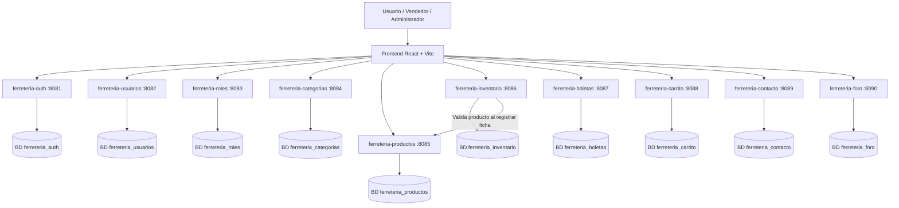
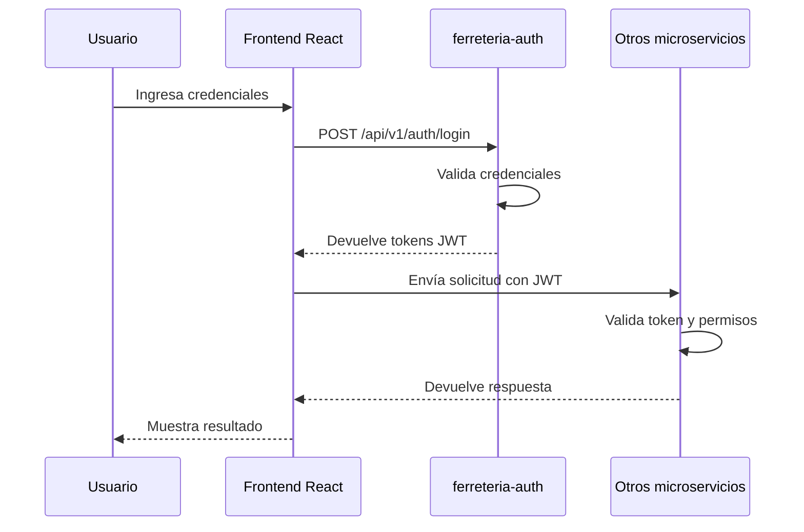
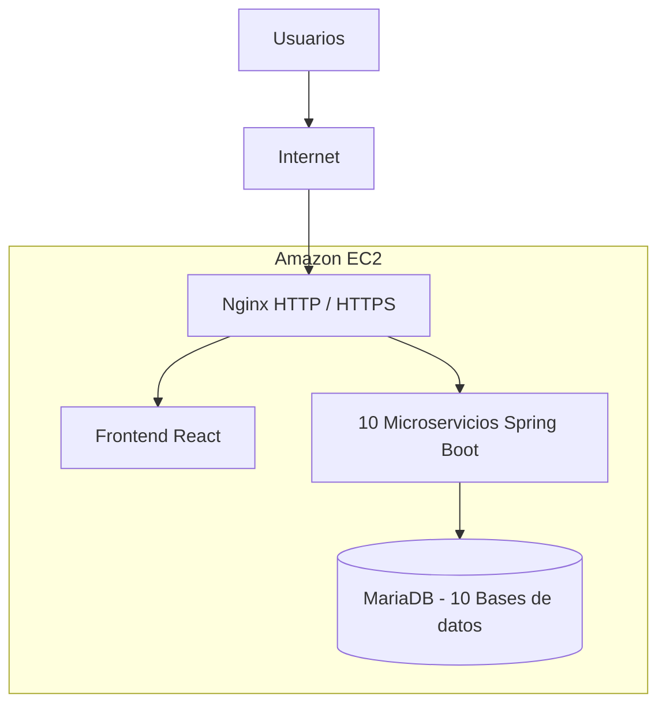

# 🔨 Ferretería Los Maestros | Backend

Sistema web de una ferretería que permite gestionar productos, categorías, usuarios, ventas, inventario, carrito de compras, contacto y un foro para los clientes.

**Desarrollo Fullstack II (DSY1104) | Ingeniería en Informática | Duoc UC**


---

## 1. ¿De qué trata el proyecto?

**Ferretería Los Maestros** es un proyecto basado en una ferretería familiar ubicada en La Serena, Región de Coquimbo.

La idea es crear una página web donde los clientes puedan revisar productos, realizar compras, consultar su historial y participar en un foro. También cuenta con funciones para vendedores y administradores.

El backend está desarrollado con **Java y Spring Boot**, utilizando una estructura de 10 microservicios. Cada uno se encarga de una parte diferente del sistema.

El frontend está desarrollado con **React y Vite**, y se comunica con los servicios backend mediante API REST.

---

## 2. Objetivos

### Objetivo general

Desarrollar una página web para Ferretería Los Maestros que permita administrar sus productos, usuarios y ventas, además de entregar herramientas para que los clientes puedan realizar sus compras.

### Objetivos específicos

- Crear 10 microservicios utilizando Spring Boot.
- Crear y conectar las bases de datos de cada servicio.
- Implementar operaciones para crear, consultar, modificar y eliminar información.
- Conectar el backend con el frontend desarrollado en React.
- Implementar inicio de sesión y registro de usuarios.
- Utilizar JWT para mantener la autenticación.
- Manejar diferentes permisos según el tipo de usuario.
- Documentar las API mediante Swagger.
- Realizar pruebas de funcionamiento.
- Preparar el proyecto para su despliegue en AWS.

---

## 3. Arquitectura del sistema

El proyecto está organizado en **10 microservicios independientes**, cada uno con su propia carpeta, configuración y base de datos.

Todos se encuentran dentro del repositorio `ferreteria-backend`.

### Diagrama general



### Características principales

- Cada microservicio tiene una función específica.
- Los servicios se comunican mediante API REST.
- Cada servicio utiliza su propia base de datos.
- El acceso a las funciones depende del rol del usuario.
- La autenticación se realiza mediante JWT.

---

## 4. Microservicios del proyecto

El backend cuenta con los siguientes 10 servicios:

| Microservicio | Puerto | Función |
|---|---:|---|
| `ferreteria-auth` | 8081 | Registro, inicio de sesión y generación de tokens JWT. |
| `ferreteria-usuarios` | 8082 | Administración de usuarios. |
| `ferreteria-roles` | 8083 | Administración de roles. |
| `ferreteria-categorias` | 8084 | Creación y administración de categorías. |
| `ferreteria-productos` | 8085 | Administración del catálogo de productos. |
| `ferreteria-inventario` | 8086 | Control de stock y existencias. |
| `ferreteria-boletas` | 8087 | Registro de ventas y boletas. |
| `ferreteria-carrito` | 8088 | Administración del carrito de compras. |
| `ferreteria-contacto` | 8089 | Recepción y administración de mensajes. |
| `ferreteria-foro` | 8090 | Publicaciones y comentarios de usuarios. |

### Otros puertos utilizados

| Componente | Puerto |
|---|---:|
| Frontend React + Vite | 5173 |
| MySQL / MariaDB | 3306 |
| Nginx HTTP | 80 |
| Nginx HTTPS | 443 |

---

## 5. Tecnologías utilizadas

### Backend

- Java 21.
- Spring Boot 4.1.2.
- Spring Web.
- Spring Data JPA.
- Hibernate.
- Spring Security.
- JWT y JJWT.
- Jakarta Validation.
- Lombok.
- Maven.

### Frontend

- React.
- Vite.
- JavaScript.
- HTML5.
- CSS3.
- Bootstrap.
- React Router.
- Fetch API.

### Bases de datos

- MySQL.
- MariaDB.
- MySQL Connector/J.
- phpMyAdmin.

### Herramientas

- Visual Studio Code.
- IntelliJ IDEA.
- Postman.
- Swagger.
- Git.
- GitHub.
- Spring Initializr.

### Despliegue

- Amazon Web Services (AWS).
- Amazon EC2.
- Ubuntu Linux.
- Nginx.
- MariaDB.

---

## 6. Estructura del repositorio

La organización del backend es la siguiente:

```text
ferreteria-backend/
│
├── ferreteria-auth/
├── ferreteria-usuarios/
├── ferreteria-roles/
├── ferreteria-categorias/
├── ferreteria-productos/
├── ferreteria-inventario/
├── ferreteria-boletas/
├── ferreteria-carrito/
├── ferreteria-contacto/
├── ferreteria-foro/
│
└── README.md
```

Cada carpeta contiene un proyecto Spring Boot independiente.

### Estructura interna de un microservicio

Como ejemplo, se muestra la organización de `ferreteria-contacto`:

```text
ferreteria-contacto/
│
├── .mvn/
│   └── wrapper/
│
├── src/
│   └── main/
│       ├── java/
│       │   └── cl/
│       │       └── duoc/
│       │           └── ferreteria_contacto/
│       │               ├── config/
│       │               ├── controller/
│       │               ├── dto/
│       │               ├── exception/
│       │               ├── model/
│       │               ├── repository/
│       │               ├── security/
│       │               ├── service/
│       │               └── FerreteriaContactoApplication.java
│       │
│       └── resources/
│           └── application.properties
│
├── .gitattributes
├── .gitignore
├── mvnw
├── mvnw.cmd
└── pom.xml
```

### ¿Para qué sirve cada carpeta?

| Carpeta | Función |
|---|---|
| `model` | Contiene las entidades del proyecto. |
| `repository` | Permite trabajar con la base de datos. |
| `service` | Contiene la lógica del sistema. |
| `controller` | Recibe las solicitudes HTTP. |
| `dto` | Contiene los objetos utilizados para enviar y recibir datos. |
| `exception` | Maneja los errores del sistema. |
| `config` | Contiene configuraciones generales. |
| `security` | Maneja la seguridad y validación de JWT. |

### Flujo de funcionamiento


---

## 7. Funcionalidades de los microservicios

### 7.1. ferreteria-auth

Se encarga del registro e inicio de sesión de los usuarios.

Funciones principales:

- Registro de usuarios.
- Inicio de sesión.
- Validación de credenciales.
- Generación de JWT.
- Renovación de tokens.
- Manejo de roles.

Endpoints principales:

| Método | Endpoint |
|---|---|
| POST | `/api/v1/auth/registro` |
| POST | `/api/v1/auth/login` |
| POST | `/api/v1/auth/refresh` |

### 7.2. ferreteria-usuarios

Permite administrar los usuarios registrados.

Funciones principales:

- Consultar usuarios.
- Buscar usuarios por ID.
- Crear y modificar usuarios.
- Eliminar usuarios.
- Cambiar el estado de las cuentas.

### 7.3. ferreteria-roles

Permite administrar los roles disponibles en el sistema.

Funciones principales:

- Crear roles.
- Consultar roles.
- Modificar roles.
- Eliminar roles de forma controlada.

### 7.4. ferreteria-categorias

Se encarga de organizar los productos de la ferretería.

Funciones principales:

- Consultar categorías.
- Crear categorías.
- Editar categorías.
- Eliminar categorías.

### 7.5. ferreteria-productos

Administra los productos disponibles en la tienda.

Funciones principales:

- Consultar el catálogo.
- Consultar el detalle de productos.
- Registrar nuevos productos.
- Modificar productos.
- Eliminar productos.
- Asociar productos con categorías.

### 7.6. ferreteria-inventario

Permite controlar las existencias de los productos.

Funciones principales:

- Consultar stock.
- Registrar existencias.
- Actualizar cantidades.
- Definir stock mínimo.
- Revisar disponibilidad de productos.

### 7.7. ferreteria-boletas

Se encarga de registrar las ventas y generar las boletas.

Funciones principales:

- Registrar compras.
- Generar boletas.
- Consultar historial de compras.
- Consultar ventas.
- Calcular subtotales y totales.

### 7.8. ferreteria-carrito

Administra el carrito de compras de cada usuario.

Funciones principales:

- Consultar carrito.
- Agregar productos.
- Modificar cantidades.
- Eliminar productos.
- Vaciar el carrito después de completar una compra.

### 7.9. ferreteria-contacto

Recibe y administra los mensajes enviados desde el formulario de contacto.

**Endpoints implementados:**

| Método | Endpoint | Acceso |
|---|---|---|
| GET | `/api/v1/contacto` | ADMIN / VENDEDOR |
| GET | `/api/v1/contacto/{id}` | ADMIN / VENDEDOR |
| POST | `/api/v1/contacto` | Público |
| PUT | `/api/v1/contacto/{id}/responder` | ADMIN / VENDEDOR |
| DELETE | `/api/v1/contacto/{id}` | ADMIN |

**Ejemplo de solicitud POST:**

```json
{
  "nombre": "Maestro Constructor",
  "correo": "cliente@gmail.com",
  "asunto": "Cotización de herramientas eléctricas",
  "mensaje": "Necesito cotizar 5 taladros percutores para obra en La Serena."
}
```

### 7.10. ferreteria-foro

Permite que los usuarios compartan publicaciones y comentarios.

Funciones principales:

- Consultar publicaciones.
- Crear publicaciones.
- Agregar comentarios.
- Consultar comentarios.
- Eliminar publicaciones (ADMIN).

---

## 8. Bases de datos

El proyecto utiliza MySQL y MariaDB para guardar la información.

Cada microservicio tiene su propia base de datos, separando la información según la función que cumple dentro del sistema.

### Bases de datos utilizadas

| Microservicio | Base de datos |
|---|---|
| ferreteria-auth | `ferreteria_auth` |
| ferreteria-usuarios | `ferreteria_usuarios` |
| ferreteria-roles | `ferreteria_roles` |
| ferreteria-categorias | `ferreteria_categorias` |
| ferreteria-productos | `ferreteria_productos` |
| ferreteria-inventario | `ferreteria_inventario` |
| ferreteria-boletas | `ferreteria_boletas` |
| ferreteria-carrito | `ferreteria_carrito` |
| ferreteria-contacto | `ferreteria_contacto` |
| ferreteria-foro | `ferreteria_foro` |

Para trabajar con las bases de datos se utilizan Spring Data JPA e Hibernate.

---

## 9. Seguridad y autenticación

Para proteger el sistema se utiliza Spring Security junto con JWT.

Los usuarios tienen diferentes permisos dependiendo de su rol.

### Roles del sistema

| Rol | Permisos |
|---|---|
| ADMIN | Puede administrar todos los módulos del sistema. |
| VENDEDOR | Puede gestionar productos, categorías, inventario, boletas y mensajes de contacto. |
| CLIENTE | Puede utilizar el carrito, consultar sus compras y participar en el foro. |
| Público | Puede consultar información pública y enviar mensajes de contacto. |

### ¿Cómo funciona el inicio de sesión?

1. El usuario ingresa su correo y contraseña.
2. El frontend envía los datos a `ferreteria-auth`.
3. El servicio valida las credenciales.
4. Si los datos son correctos, genera los tokens JWT.
5. El frontend utiliza el token para comunicarse con los demás microservicios.
6. Los servicios validan el token y los permisos del usuario.

### Diagrama de autenticación



### Encabezado utilizado

```http
Authorization: Bearer <token>
```

### Seguridad implementada

- Contraseñas protegidas mediante BCrypt.
- Autenticación con JWT.
- Validación de tokens.
- Control de acceso por roles.
- Configuración CORS.
- Manejo de sesiones `STATELESS`.
- Variables de entorno para proteger credenciales.

### Respuestas HTTP de seguridad

| Código | Significado |
|---|---|
| 200 | Solicitud realizada correctamente. |
| 201 | Registro creado. |
| 204 | Operación realizada sin contenido de respuesta. |
| 400 | Datos incorrectos. |
| 401 | Usuario no autenticado o token inválido. |
| 403 | Usuario sin permisos. |
| 404 | Recurso no encontrado. |

---

## 10. Instalación y ejecución

### Requisitos

Antes de ejecutar el proyecto se necesita tener instalado:

- Java JDK 21.
- MySQL o MariaDB.
- Git.
- Maven.
- Node.js y npm para el frontend.
- Visual Studio Code o IntelliJ IDEA.

### 10.1. Clonar el repositorio

```bash
git clone https://github.com/kevishowardgonzalez/ferreteria-backend.git
```

Ingresar a la carpeta:

```bash
cd ferreteria-backend
```

### 10.2. Crear las bases de datos

Si las bases de datos no se crean automáticamente, se pueden crear manualmente desde MySQL:

```sql
CREATE DATABASE IF NOT EXISTS ferreteria_auth CHARACTER SET utf8mb4 COLLATE utf8mb4_unicode_ci;

CREATE DATABASE IF NOT EXISTS ferreteria_usuarios CHARACTER SET utf8mb4 COLLATE utf8mb4_unicode_ci;

CREATE DATABASE IF NOT EXISTS ferreteria_roles CHARACTER SET utf8mb4 COLLATE utf8mb4_unicode_ci;

CREATE DATABASE IF NOT EXISTS ferreteria_categorias CHARACTER SET utf8mb4 COLLATE utf8mb4_unicode_ci;

CREATE DATABASE IF NOT EXISTS ferreteria_productos CHARACTER SET utf8mb4 COLLATE utf8mb4_unicode_ci;

CREATE DATABASE IF NOT EXISTS ferreteria_inventario CHARACTER SET utf8mb4 COLLATE utf8mb4_unicode_ci;

CREATE DATABASE IF NOT EXISTS ferreteria_boletas CHARACTER SET utf8mb4 COLLATE utf8mb4_unicode_ci;

CREATE DATABASE IF NOT EXISTS ferreteria_carrito CHARACTER SET utf8mb4 COLLATE utf8mb4_unicode_ci;

CREATE DATABASE IF NOT EXISTS ferreteria_contacto CHARACTER SET utf8mb4 COLLATE utf8mb4_unicode_ci;

CREATE DATABASE IF NOT EXISTS ferreteria_foro CHARACTER SET utf8mb4 COLLATE utf8mb4_unicode_ci;
```

### 10.3. Configurar variables de entorno

Cada microservicio necesita sus datos de conexión y configuración.

| Variable | Descripción |
|---|---|
| `DB_URL` | Dirección de la base de datos. |
| `DB_USER` | Usuario de MySQL o MariaDB. |
| `DB_PASSWORD` | Contraseña de la base de datos. |
| `JWT_SECRET` | Clave compartida por Auth y sus nueve consumidores, en Base64 con al menos 32 bytes aleatorios antes de codificar. Inyectarla mediante el entorno de cada proceso. |
| `JWT_ISSUER` | Emisor compartido por los diez procesos. El valor predeterminado es `ferreteria-auth`. |
| `APP_CORS_ALLOWED_ORIGIN` | Dirección permitida del frontend. |
| `PRODUCTOS_API_URL` | Solo en Inventario. URL base de Productos, sin `/api/productos`. Predeterminada `http://localhost:8085`. |

**Ejemplo para Windows CMD:**

```cmd
set "DB_USER=ferreteria_app"
set "DB_PASSWORD=TU_CLAVE"
set "JWT_SECRET=TU_SECRETO_COMPARTIDO"
set "JWT_ISSUER=ferreteria-auth"
set "APP_CORS_ALLOWED_ORIGIN=http://localhost:5173"
```

**Importante:** No subir contraseñas ni claves reales a GitHub.

### 10.4. Ejecutar un microservicio

Por ejemplo, para iniciar `ferreteria-auth`:

**Windows CMD:**

```cmd
cd ferreteria-auth
mvnw.cmd spring-boot:run
```

**Linux / macOS:**

```bash
cd ferreteria-auth
./mvnw spring-boot:run
```

Los demás microservicios se ejecutan de la misma manera, ingresando primero a su respectiva carpeta.

### 10.5. Compilar el proyecto

En Windows:

```cmd
mvnw.cmd clean compile
```

Para generar el archivo JAR:

```cmd
mvnw.cmd clean package
```

Los archivos generados se guardan dentro de la carpeta `target` de cada microservicio.

Usa una base MySQL por servicio y configura `DB_URL` por proceso si sobrescribes la
dirección local. Para probar el catálogo y el panel de Inventario inicia Auth,
Categorías, Productos e Inventario con el mismo emisor y material de firma.
Genera el secreto fuera del repositorio (por ejemplo, con `openssl rand -base64 32`)
y guárdalo en el entorno de ejecución. Si un valor antiguo se usó en un entorno
desplegado, rótalo coordinadamente en los diez procesos.

### 10.6. API y permisos de Inventario

Rutas relativas a `/api/v1/inventario` (puerto 8086).

| Método y ruta | ADMIN | VENDEDOR | CLIENTE | Visitante |
|---|---|---|---|---|
| GET `/` (sin barra final en la URL) | Sí | Sí | 403 | 401 |
| GET `/producto/{productoId}` | Sí | Sí | Sí | Sí |
| GET `/producto/{productoId}/movimientos` | Sí | 403 | 403 | 401 |
| POST al prefijo base | Sí | 403 | 403 | 401 |
| POST `/movimientos` | Sí | 403 | 403 | 401 |

El alta recibe `productoId`, `productoSku`, `productoNombre`, `stockActual` y
`stockMinimo` opcional (5 por defecto). Responde 201, 400 para datos inválidos
o duplicados, 404 si no existe el producto, 409 si está retirado, 502 si Productos
responde con datos inválidos y 503 si el servicio no está disponible.
Un movimiento recibe `productoId`, `tipo`, `cantidad` y
`motivo` opcional. ENTRADA y SALIDA requieren una cantidad positiva. AJUSTE
establece un saldo absoluto y admite cero. El éxito devuelve 200 con la ficha.

`InventarioItem.stockActual` es la fuente oficial de existencias.
`Producto.stock` es un atributo legado. La baja lógica conserva las fichas
y el historial. El registro de nuevos productos desde React coordina dos
solicitudes independientes y permite recuperar fichas pendientes.

El equipo autorizó dos técnicas adicionales a las guías revisadas. Inventario
usa bloqueo pesimista JPA por ficha para actualizar saldo e historial en una
transacción local, y usa `RestClient` de Spring para consultar el GET público
de Productos antes del alta. La consulta no forma una transacción distribuida.
Un producto podría retirarse entre la consulta y el alta, y conservaría su
identificador por la baja lógica.

Para bases existentes, aplica el [procedimiento de unicidad de SKU](docs/inventario-sku-unico.md)
antes de habilitar escrituras. El próximo trabajo corresponde a carrito,
compras y boletas, incluido el descuento de existencias al confirmar una compra.

---

## 11. Swagger y documentación de API

Cada microservicio cuenta con documentación mediante Swagger UI y OpenAPI.

Las direcciones locales son:

| Microservicio | Swagger UI |
|---|---|
| ferreteria-auth | [Abrir Swagger](http://localhost:8081/swagger-ui.html) |
| ferreteria-usuarios | [Abrir Swagger](http://localhost:8082/swagger-ui.html) |
| ferreteria-roles | [Abrir Swagger](http://localhost:8083/swagger-ui.html) |
| ferreteria-categorias | [Abrir Swagger](http://localhost:8084/swagger-ui.html) |
| ferreteria-productos | [Abrir Swagger](http://localhost:8085/swagger-ui.html) |
| ferreteria-inventario | [Abrir Swagger](http://localhost:8086/swagger-ui.html) |
| ferreteria-boletas | [Abrir Swagger](http://localhost:8087/swagger-ui.html) |
| ferreteria-carrito | [Abrir Swagger](http://localhost:8088/swagger-ui.html) |
| ferreteria-contacto | [Abrir Swagger](http://localhost:8089/swagger-ui.html) |
| ferreteria-foro | [Abrir Swagger](http://localhost:8090/swagger-ui.html) |

Para probar los endpoints protegidos se debe utilizar el botón **Authorize** de Swagger e ingresar un token JWT válido.

---

## 12. Pruebas del proyecto

Para revisar que los servicios funcionen correctamente se utilizan diferentes herramientas:

- Postman.
- Swagger UI.
- JUnit 5.
- Mockito.
- Spring Boot Test.
- MySQL Workbench.
- phpMyAdmin.

Se realizan pruebas de registro, inicio de sesión, consultas, creación y modificación de datos, validación de permisos y conexión con las bases de datos.

---

## 13. Conexión con el frontend

El frontend está desarrollado con React y Vite.

Para comunicarse con el backend utiliza solicitudes HTTP mediante `fetch` o `axios`.

Las direcciones de los microservicios se configuran mediante variables de entorno:

```env
VITE_AUTH_API_URL=http://localhost:8081

VITE_USUARIOS_API_URL=http://localhost:8082

VITE_ROLES_API_URL=http://localhost:8083

VITE_CATEGORIAS_API_URL=http://localhost:8084

VITE_PRODUCTOS_API_URL=http://localhost:8085

VITE_INVENTARIO_API_URL=http://localhost:8086

VITE_BOLETAS_API_URL=http://localhost:8087

VITE_CARRITO_API_URL=http://localhost:8088

VITE_CONTACTO_API_URL=http://localhost:8089

VITE_FORO_API_URL=http://localhost:8090
```

---

## 14. Despliegue en AWS

Se contempla utilizar Amazon Web Services para publicar el proyecto y permitir el acceso desde internet.

Los servicios considerados son:

- **Amazon EC2:** servidor donde se ejecutará la aplicación.
- **Ubuntu Linux:** sistema operativo del servidor.
- **Java:** ejecución de los microservicios.
- **MariaDB:** almacenamiento de información.
- **Nginx:** publicación del frontend y redirección de solicitudes al backend.
- **systemd:** administración de los servicios.

### Diagrama de despliegue



---

## 15. Git y GitHub

Para desarrollar el proyecto y guardar los cambios se utiliza Git y GitHub.

Algunas de las convenciones utilizadas para los commits son:

- `feat:` nuevas funcionalidades.
- `fix:` corrección de errores.
- `docs:` cambios en la documentación.
- `chore:` tareas de mantenimiento.

### Repositorio

[Ver repositorio en GitHub](https://github.com/kevishowardgonzalez/ferreteria-backend)

---

## 16. Equipo de desarrollo

Proyecto realizado en equipo por estudiantes de Ingeniería en Informática de Duoc UC.

| Integrante | Trabajo realizado |
|---|---|
| Kevis González | Desarrollo y organización del backend, microservicios y bases de datos. |
| Yerickson Rodríguez | Integración del frontend, carrito, checkout y pruebas funcionales. |
| Javier Cruz | Panel administrativo, usuarios, mantenedores y documentación. |

---

## 17. Proyecto académico

**Asignatura:** Desarrollo Fullstack II (DSY1104)

**Carrera:** Ingeniería en Informática

**Institución:** Duoc UC

**Año:** 2026

El proyecto busca aplicar los conocimientos adquiridos durante la asignatura, trabajando con Java, Spring Boot, React, bases de datos, API REST y GitHub.

---

<div align="center">

# 🔨 FERRETERÍA LOS MAESTROS

**Desarrollo Fullstack II — Duoc UC**

*Proyecto académico 2026*

</div>
