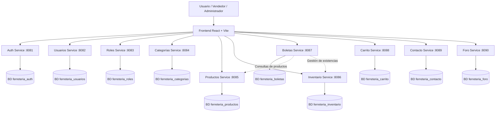
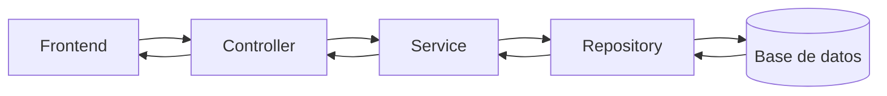
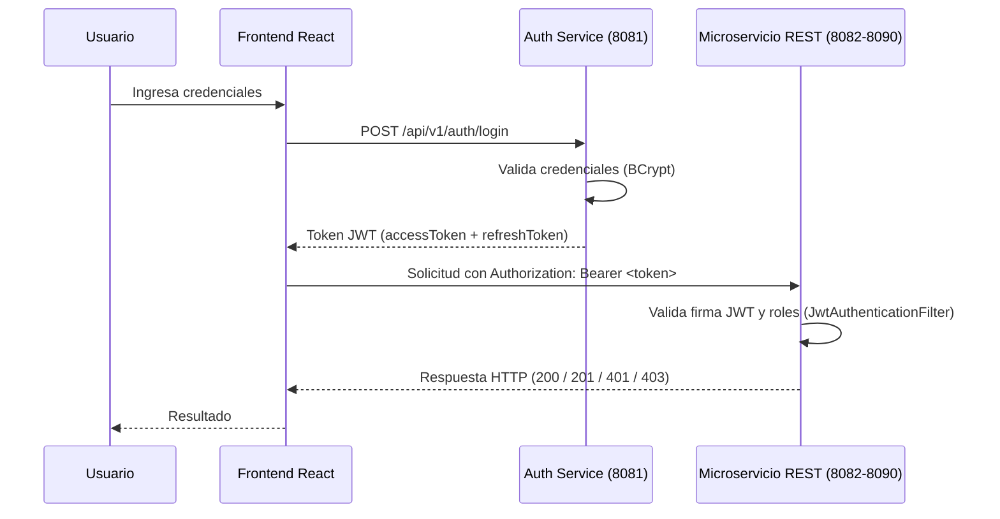
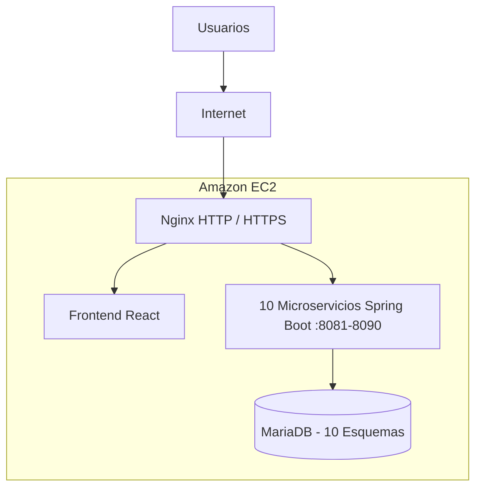

# 🔨 Ferretería Los Maestros | Backend

Plataforma de comercio electrónico especializada en herramientas, materiales de construcción, gasfitería, electricidad y artículos de ferretería general.

**Desarrollo Fullstack II (DSY1104) | Ingeniería en Informática | Duoc UC**


---

## 1. Descripción del proyecto

**Ferretería Los Maestros** es una empresa familiar fundada en La Serena, Región de Coquimbo, orientada a la comercialización de herramientas y materiales de construcción para contratistas, maestros de obra y clientes particulares, complementada con un foro comunitario y canales de atención al cliente.

Este repositorio concentra los servicios backend de la plataforma, diseñados mediante una arquitectura de **10 microservicios independientes** desarrollados con **Spring Boot**.

La solución contempla la implementación de API REST, persistencia de datos independiente por dominio, lógica de negocio, validación de información, autenticación mediante JSON Web Tokens (JWT), autorización basada en roles (`ADMIN`, `VENDEDOR`, `CLIENTE`) y documentación de endpoints mediante Swagger / OpenAPI.

El frontend se desarrolla de forma independiente utilizando React y Vite, estableciendo comunicación con los servicios backend mediante solicitudes HTTP e intercambio de información en formato JSON.

El proyecto se desarrolla de manera incremental, incorporando progresivamente los microservicios, sus pruebas unitarias y la integración con el frontend.

---

## 2. Objetivos del proyecto

### Objetivo general

Desarrollar una plataforma web Full Stack que permita gestionar las operaciones comerciales y administrativas de **Ferretería Los Maestros** mediante una arquitectura de microservicios modular, segura, escalable y mantenible.

### Objetivos específicos

- Implementar 10 servicios backend independientes utilizando Spring Boot.
- Diseñar modelos de datos relacionados con los requerimientos funcionales del negocio.
- Gestionar la persistencia de información mediante bases de datos relacionales independientes.
- Implementar operaciones CRUD mediante API REST.
- Documentar los endpoints utilizando Swagger y OpenAPI.
- Integrar los servicios backend con el frontend desarrollado en React.
- Implementar autenticación mediante JWT con emisión centralizada y validación distribuida.
- Establecer mecanismos de autorización basados en roles y permisos.
- Gestionar la persistencia de sesiones de usuario de forma *stateless*.
- Validar la información ingresada mediante formularios y solicitudes HTTP.
- Aplicar buenas prácticas de desarrollo, seguridad y control de versiones.
- Preparar la aplicación para su despliegue en infraestructura cloud.

---

## 3. Arquitectura del sistema

**Ferretería Los Maestros** contempla una arquitectura compuesta por **diez microservicios Spring Boot**, organizados dentro de un repositorio backend común (`ferreteria-backend`).

Cada microservicio dispone de su propio proyecto Maven, configuración, responsabilidades funcionales y esquema de base de datos independiente (*Database per Service*).

### Diagrama general de arquitectura



El diagrama representa la arquitectura objetivo del proyecto. Las comunicaciones entre microservicios serán verificadas durante la integración.

### Principios de arquitectura

- Separación de responsabilidades por dominio de negocio.
- Independencia funcional de los microservicios.
- Comunicación mediante API REST.
- Persistencia independiente por dominio (Database per Service).
- Modularidad y mantenibilidad.
- Validación de reglas de negocio.
- Centralización del manejo de excepciones (`GlobalExceptionHandler`).
- Seguridad mediante autenticación JWT y autorización RBAC.
- Externalización de configuraciones sensibles.
- Preparación para despliegue independiente.

---

## 4. Microservicios

La plataforma contempla los siguientes diez microservicios:

| Microservicio | Carpeta | Puerto | Base de datos prevista | Responsabilidad |
|---|---|---:|---|---|
| Auth Service | `ferreteria-auth` | 8081 | `ferreteria_auth` | Autenticación, registro inicial, generación y renovación de JWT. |
| Usuarios Service | `ferreteria-usuarios` | 8082 | `ferreteria_usuarios` | Registro, perfiles y administración de usuarios. |
| Roles Service | `ferreteria-roles` | 8083 | `ferreteria_roles` | Administración y asignación de roles del sistema. |
| Categorías Service | `ferreteria-categorias` | 8084 | `ferreteria_categorias` | Organización y clasificación del catálogo de productos. |
| Productos Service | `ferreteria-productos` | 8085 | `ferreteria_productos` | Administración del catálogo de herramientas y materiales. |
| Inventario Service | `ferreteria-inventario` | 8086 | `ferreteria_inventario` | Control de stock, movimientos y disponibilidad. |
| Boletas Service | `ferreteria-boletas` | 8087 | `ferreteria_boletas` | Gestión de ventas, boletas y detalles de compra. |
| Carrito Service | `ferreteria-carrito` | 8088 | `ferreteria_carrito` | Gestión persistente del carro de compras por usuario. |
| Contacto Service | `ferreteria-contacto` | 8089 | `ferreteria_contacto` | Recepción y administración de mensajes de contacto. |
| Foro Service | `ferreteria-foro` | 8090 | `ferreteria_foro` | Gestión de publicaciones comunitarias y comentarios. |

### Puertos complementarios

| Componente | Puerto |
|---|---:|
| Frontend React + Vite | 5173 |
| MySQL / MariaDB | 3306 |
| Servidor HTTP Nginx | 80 |
| Servidor HTTPS Nginx | 443 |

Los nombres y configuraciones de los servicios pendientes podrán ajustarse durante la integración definitiva.

---

## 5. Tecnologías utilizadas

### Backend

| Tecnología | Propósito |
|---|---|
| Java 17+ | Lenguaje principal de programación. |
| Spring Boot | Desarrollo y configuración de microservicios. |
| Spring Web MVC | Implementación de API REST. |
| Spring Data JPA | Acceso y persistencia de datos. |
| Hibernate | Mapeo objeto-relacional (ORM). |
| Spring Security | Seguridad y control de acceso. |
| JWT | Autenticación basada en tokens. |
| JJWT | Generación y validación de tokens JWT. |
| Jakarta Validation | Validación de datos de entrada. |
| Lombok | Reducción de código repetitivo. |
| Maven | Gestión de dependencias y compilación. |
| Swagger / OpenAPI | Documentación de API REST. |

### Frontend

- React.
- Vite.
- JavaScript (ES6+).
- HTML5.
- CSS3.
- Bootstrap / React-Bootstrap.
- React Router.
- Fetch API.

### Base de datos

- MySQL.
- MariaDB.
- MySQL Connector/J.
- phpMyAdmin.
- XAMPP para el entorno de desarrollo local.

### Herramientas de desarrollo

- Visual Studio Code / IntelliJ IDEA.
- Spring Initializr.
- Postman.
- Swagger UI.
- Git.
- GitHub.
- Maven Wrapper.

### Infraestructura prevista

- Amazon Web Services (AWS).
- Amazon EC2.
- Linux Ubuntu.
- Nginx.
- MariaDB.
- systemd.

Las versiones específicas de las dependencias se encuentran definidas en el archivo `pom.xml` de cada microservicio.

---

## 6. Estructura del repositorio

La estructura del repositorio backend es la siguiente:

```text
ferreteria-backend/
│
├── ferreteria-auth/
│
├── ferreteria-usuarios/
│
├── ferreteria-roles/
│
├── ferreteria-categorias/
│
├── ferreteria-productos/
│
├── ferreteria-inventario/
│
├── ferreteria-boletas/
│
├── ferreteria-carrito/
│
├── ferreteria-contacto/
│
├── ferreteria-foro/
│
└── README.md
```

Cada microservicio constituye un proyecto Spring Boot independiente.

### Estructura interna de referencia

```text
ferreteria-contacto/
│
├── .mvn/
│   └── wrapper/
│
├── src/
│   └── main/
│       ├── java/
│       │   └── cl/
│       │       └── duoc/
│       │           └── ferreteria_contacto/
│       │               ├── config/
│       │               ├── controller/
│       │               ├── dto/
│       │               ├── exception/
│       │               ├── model/
│       │               ├── repository/
│       │               ├── security/
│       │               ├── service/
│       │               └── FerreteriaContactoApplication.java
│       │
│       └── resources/
│           └── application.properties
│
├── .gitattributes
├── .gitignore
├── mvnw
├── mvnw.cmd
└── pom.xml
```

### Arquitectura por capas

| Capa | Responsabilidad |
|---|---|
| Model | Definición de entidades y atributos del dominio. |
| Repository | Acceso y persistencia de información. |
| Service | Implementación de lógica y reglas de negocio. |
| Controller | Exposición de endpoints REST. |
| Exception | Gestión centralizada de errores y excepciones (`GlobalExceptionHandler`). |
| Config / Security | Configuración de seguridad, filtros JWT, CORS y Swagger. |
| DTO | Transferencia controlada de información y validaciones de entrada. |

### Flujo de procesamiento



---

## 7. API REST y funcionalidades

Los microservicios utilizan el protocolo HTTP y el formato JSON para intercambiar información.

### Métodos HTTP

| Método | Operación |
|---|---|
| GET | Consultar información. |
| POST | Crear nuevos registros. |
| PUT | Actualizar registros existentes. |
| DELETE | Eliminar registros cuando las reglas del negocio lo permitan. |

### Recursos principales

| Microservicio | Ruta base |
|---|---|
| Auth | `/api/v1/auth` |
| Usuarios | `/api/v1/usuarios` |
| Roles | `/api/v1/roles` |
| Categorías | `/api/v1/categorias` |
| Productos | `/api/v1/productos` |
| Inventario | `/api/v1/inventario` |
| Boletas | `/api/v1/boletas` |
| Carrito | `/api/v1/carrito` |
| Contacto | `/api/v1/contacto` |
| Foro | `/api/v1/foro` |

### 7.1. Auth Service (`ferreteria-auth`)

Responsable de la autenticación y seguridad de los usuarios.

**Funcionalidades implementadas:**

- Inicio de sesión (`/api/v1/auth/login`).
- Registro de nuevos usuarios (`/api/v1/auth/register`).
- Renovación segura de tokens (`/api/v1/auth/refresh`).
- Validación de credenciales con cifrado BCrypt.
- Generación de tokens JWT con firma HMAC-SHA256 e identificación de roles (`ADMIN`, `VENDEDOR`, `CLIENTE`).

### 7.2. Usuarios Service (`ferreteria-usuarios`)

Responsable de la administración de usuarios de la plataforma.

**Funcionalidades implementadas:**

- Consulta del listado completo de usuarios (ADMIN).
- Consulta de usuario por ID (ADMIN).
- Creación y edición de cuentas de usuario (ADMIN).
- Eliminación y cambio de estado de usuarios (ADMIN).

### 7.3. Roles Service (`ferreteria-roles`)

Responsable de la administración de roles del sistema.

**Funcionalidades implementadas:**

- Creación y consulta de roles disponibles (ADMIN).
- Actualización y eliminación controlada de roles (ADMIN).

### 7.4. Categorías Service (`ferreteria-categorias`)

Responsable de organizar y clasificar los productos de la ferretería.

**Funcionalidades implementadas:**

- Consulta pública de categorías (`GET /api/v1/categorias`).
- Creación, edición y eliminación de categorías (ADMIN, VENDEDOR).

### 7.5. Productos Service (`ferreteria-productos`)

Responsable de administrar el catálogo comercial de Ferretería Los Maestros.

**Funcionalidades implementadas:**

- Consulta pública del catálogo y detalle de productos (`GET /api/v1/productos`).
- Registro y actualización de productos (ADMIN, VENDEDOR).
- Asociación por identificador con categorías (`categoriaId`).
- Eliminación controlada de productos (ADMIN, VENDEDOR).

### 7.6. Inventario Service (`ferreteria-inventario`)

Responsable del control de existencias por producto.

**Funcionalidades implementadas:**

- Consulta pública de stock disponible por producto (`GET /api/v1/inventario/producto/{id}`).
- Registro y ajuste de existencias y stock mínimo (ADMIN, VENDEDOR).
- Validación de disponibilidad para ventas.

### 7.7. Boletas Service (`ferreteria-boletas`)

Responsable de gestionar las operaciones de venta y comprobantes de compra.

**Funcionalidades implementadas:**

- Generación de boletas con detalle de ítems para usuarios autenticados.
- Consulta de historial de compras por cliente autenticado.
- Administración y consulta general de boletas (ADMIN, VENDEDOR).
- Cálculo automático de subtotales y montos totales.

### 7.8. Carrito Service (`ferreteria-carrito`)

Responsable de gestionar el carro de compras persistente de cada usuario autenticado.

**Funcionalidades implementadas:**

- Consulta del carrito activo del usuario autenticado.
- Agregar productos y actualizar cantidades.
- Eliminar ítems o vaciar el carrito tras completar la compra.

### 7.9. Contacto Service (`ferreteria-contacto`)

Responsable de recibir y administrar los mensajes enviados mediante el formulario de contacto.

**Endpoints implementados:**

| Método | Endpoint | Acceso | Respuesta |
|---|---|---|---|
| GET | `/api/v1/contacto` | ADMIN / VENDEDOR | 200 OK |
| GET | `/api/v1/contacto/{id}` | ADMIN / VENDEDOR | 200 OK |
| POST | `/api/v1/contacto` | Público | 201 Created |
| PUT | `/api/v1/contacto/{id}/responder` | ADMIN / VENDEDOR | 200 OK |
| DELETE | `/api/v1/contacto/{id}` | ADMIN | 204 No Content |

**Ejemplo de solicitud POST:**

```json
{
  "nombre": "Maestro Constructor",
  "correo": "cliente@gmail.com",
  "asunto": "Cotización de herramientas eléctricas",
  "mensaje": "Necesito cotizar 5 taladros percutores para obra en La Serena."
}
```

### 7.10. Foro Service (`ferreteria-foro`)

Responsable de administrar las publicaciones comunitarias y consultas técnicas entre usuarios.

**Funcionalidades implementadas:**

- Consulta pública de publicaciones y comentarios (`GET /api/v1/foro`).
- Creación de publicaciones y comentarios para usuarios autenticados (`POST /api/v1/foro`).
- Moderación y eliminación de publicaciones (`DELETE /api/v1/foro/{id}` — solo ADMIN).

---

## 8. Persistencia y bases de datos

La plataforma utiliza bases de datos relacionales MySQL / MariaDB para garantizar la persistencia y organización de la información.

Cada microservicio contempla un esquema independiente (*Database per Service*), permitiendo separar los datos según su dominio funcional.

La persistencia se implementa mediante Spring Data JPA e Hibernate.

### Principios de persistencia

- Independencia de esquemas (`ferreteria_auth`, `ferreteria_usuarios`, `ferreteria_roles`, `ferreteria_categorias`, `ferreteria_productos`, `ferreteria_inventario`, `ferreteria_boletas`, `ferreteria_carrito`, `ferreteria_contacto`, `ferreteria_foro`).
- Integridad de datos y normalización de modelos.
- Validación de restricciones mediante Jakarta Validation.
- Persistencia de registros después de reiniciar los servicios.
- Desacoplamiento total entre tablas de distintos microservicios (referencias mediante IDs numéricos o correo del usuario autenticado).

---

## 9. Seguridad y autenticación

La arquitectura de seguridad contempla Spring Security con política `STATELESS` y autenticación basada en JSON Web Tokens (JWT).

### Roles principales

| Rol | Descripción |
|---|---|
| ADMIN | Usuario con permisos administrativos totales sobre todos los módulos. |
| VENDEDOR | Personal de tienda con permisos de gestión de catálogo, inventario, boletas y contacto. |
| CLIENTE | Usuario autenticado con acceso a carrito, boletas propias y participación en el foro. |
| Público | Visitante sin autenticación (consulta de catálogo, stock, foro y envío de contacto). |

### Flujo de autenticación



### Encabezado de autorización HTTP

```http
Authorization: Bearer <token>
```

### Mecanismos de seguridad

- Validación de la firma del token JWT con clave secreta compartida (`JWT_SECRET`).
- Verificación del emisor (`JWT_ISSUER=ferreteria-auth`).
- Validación de fecha de expiración y soporte para refresh token.
- Restricción granular de endpoints por método HTTP y rol (`hasRole` / `hasAnyRole`).
- Configuración CORS centralizada para el origen del frontend (`APP_CORS_ALLOWED_ORIGIN`).
- Externalización total de credenciales y claves privadas mediante variables de entorno.

### Códigos de respuesta de seguridad

| Código HTTP | Significado |
|---|---|
| 400 Bad Request | Datos de entrada inválidos. |
| 401 Unauthorized | Token ausente, expirado o inválido. |
| 403 Forbidden | Usuario autenticado sin los permisos/roles necesarios. |
| 404 Not Found | Recurso inexistente. |

---

## 10. Instalación y ejecución local

### Requisitos previos

- Java JDK 17 o superior.
- MySQL 8.0+ o MariaDB.
- Git.
- Maven o Maven Wrapper (`mvnw` / `mvnw.cmd`).
- Node.js y npm para el frontend.
- Visual Studio Code o IntelliJ IDEA.

### 10.1. Clonar el repositorio

```bash
git clone https://github.com/kevishowardgonzalez/ferreteria-backend.git
```

Acceder al directorio:

```bash
cd ferreteria-backend
```

### 10.2. Configuración de la base de datos

Cada microservicio crea automáticamente su esquema si `createDatabaseIfNotExist=true` está activo en la URL JDBC, o puede crearse manualmente en MySQL / MariaDB:

```sql
CREATE DATABASE IF NOT EXISTS ferreteria_auth CHARACTER SET utf8mb4 COLLATE utf8mb4_unicode_ci;

CREATE DATABASE IF NOT EXISTS ferreteria_usuarios CHARACTER SET utf8mb4 COLLATE utf8mb4_unicode_ci;

CREATE DATABASE IF NOT EXISTS ferreteria_roles CHARACTER SET utf8mb4 COLLATE utf8mb4_unicode_ci;

CREATE DATABASE IF NOT EXISTS ferreteria_categorias CHARACTER SET utf8mb4 COLLATE utf8mb4_unicode_ci;

CREATE DATABASE IF NOT EXISTS ferreteria_productos CHARACTER SET utf8mb4 COLLATE utf8mb4_unicode_ci;

CREATE DATABASE IF NOT EXISTS ferreteria_inventario CHARACTER SET utf8mb4 COLLATE utf8mb4_unicode_ci;

CREATE DATABASE IF NOT EXISTS ferreteria_boletas CHARACTER SET utf8mb4 COLLATE utf8mb4_unicode_ci;

CREATE DATABASE IF NOT EXISTS ferreteria_carrito CHARACTER SET utf8mb4 COLLATE utf8mb4_unicode_ci;

CREATE DATABASE IF NOT EXISTS ferreteria_contacto CHARACTER SET utf8mb4 COLLATE utf8mb4_unicode_ci;

CREATE DATABASE IF NOT EXISTS ferreteria_foro CHARACTER SET utf8mb4 COLLATE utf8mb4_unicode_ci;
```

### 10.3. Variables de entorno

Las configuraciones sensibles se mantienen fuera del código fuente mediante variables de entorno:

| Variable | Descripción |
|---|---|
| `DB_URL` | URL JDBC específica de la base de datos del microservicio. |
| `DB_USER` | Usuario de conexión a MySQL / MariaDB (`ferreteria_app`). |
| `DB_PASSWORD` | Contraseña de base de datos. |
| `JWT_SECRET` | Clave secreta compartida para firmar y validar tokens JWT. |
| `JWT_ISSUER` | Emisor autorizado del token (`ferreteria-auth`). |
| `APP_CORS_ALLOWED_ORIGIN` | URL del frontend autorizada por CORS (`http://localhost:5173`). |

**Ejemplo de configuración en Windows CMD:**

```cmd
set "DB_USER=ferreteria_app"

set "DB_PASSWORD=REEMPLAZAR_CON_CLAVE_SEGURA"

set "JWT_SECRET=REEMPLAZAR_CON_SECRETO_LARGO_COMPARTIDO_ENTRE_LOS_10_MS"

set "JWT_ISSUER=ferreteria-auth"

set "APP_CORS_ALLOWED_ORIGIN=http://localhost:5173"
```

**Importante:** Reemplazar los valores de ejemplo por las credenciales correspondientes. Nunca subir contraseñas ni claves JWT reales al repositorio.

### 10.4. Ejecutar un microservicio

Desde la carpeta correspondiente al microservicio (por ejemplo `ferreteria-auth`):

**Windows:**

```cmd
cd ferreteria-auth

mvnw.cmd spring-boot:run
```

**Linux o macOS:**

```bash
cd ferreteria-auth

./mvnw spring-boot:run
```

Cada servicio debe ejecutarse utilizando su puerto asignado (8081 al 8090).

### 10.5. Compilación y empaquetado

```cmd
mvnw.cmd clean compile

mvnw.cmd clean package
```

El archivo `.jar` compilado se generará dentro del directorio `target/` de cada microservicio.

---

## 11. Documentación Swagger y OpenAPI

Todos los microservicios exponen su documentación interactiva mediante Swagger UI y OpenAPI 3:

| Microservicio | URL Swagger UI | Especificación JSON |
|---|---|---|
| Auth | [Swagger](http://localhost:8081/swagger-ui.html) | [OpenAPI](http://localhost:8081/v3/api-docs) |
| Usuarios | [Swagger](http://localhost:8082/swagger-ui.html) | [OpenAPI](http://localhost:8082/v3/api-docs) |
| Roles | [Swagger](http://localhost:8083/swagger-ui.html) | [OpenAPI](http://localhost:8083/v3/api-docs) |
| Categorías | [Swagger](http://localhost:8084/swagger-ui.html) | [OpenAPI](http://localhost:8084/v3/api-docs) |
| Productos | [Swagger](http://localhost:8085/swagger-ui.html) | [OpenAPI](http://localhost:8085/v3/api-docs) |
| Inventario | [Swagger](http://localhost:8086/swagger-ui.html) | [OpenAPI](http://localhost:8086/v3/api-docs) |
| Boletas | [Swagger](http://localhost:8087/swagger-ui.html) | [OpenAPI](http://localhost:8087/v3/api-docs) |
| Carrito | [Swagger](http://localhost:8088/swagger-ui.html) | [OpenAPI](http://localhost:8088/v3/api-docs) |
| Contacto | [Swagger](http://localhost:8089/swagger-ui.html) | [OpenAPI](http://localhost:8089/v3/api-docs) |
| Foro | [Swagger](http://localhost:8090/swagger-ui.html) | [OpenAPI](http://localhost:8090/v3/api-docs) |

Para probar endpoints protegidos en Swagger UI, utilizar el botón **Authorize** ingresando el token obtenido desde `ferreteria-auth`.

---

## 12. Pruebas y validaciones

El proceso de verificación contempla pruebas unitarias, funcionales, validación de datos, persistencia, seguridad e integración entre frontend y backend.

### Herramientas de prueba

- Swagger UI.
- Postman.
- JUnit 5 / Mockito / Spring Boot Test.
- phpMyAdmin / MySQL Workbench.

### Códigos de respuesta HTTP verificados

| Código | Estado | Descripción |
|---|---|---|
| 200 | OK | Operación realizada correctamente. |
| 201 | Created | Registro creado correctamente. |
| 204 | No Content | Operación exitosa sin contenido de respuesta. |
| 400 | Bad Request | Solicitud con datos inválidos. |
| 401 | Unauthorized | Token ausente o inválido. |
| 403 | Forbidden | Acceso denegado por falta de permisos. |
| 404 | Not Found | Recurso no encontrado. |
| 500 | Internal Server Error | Error interno controlado del servidor. |

---

## 13. Integración con el frontend

El frontend de Ferretería Los Maestros está desarrollado mediante React y Vite.

La comunicación con los 10 microservicios se realiza mediante solicitudes HTTP (`fetch` / `axios`), centralizando las URLs base mediante variables de entorno de Vite:

```env
VITE_AUTH_API_URL=http://localhost:8081/api/v1/auth

VITE_USUARIOS_API_URL=http://localhost:8082/api/v1/usuarios

VITE_ROLES_API_URL=http://localhost:8083/api/v1/roles

VITE_CATEGORIAS_API_URL=http://localhost:8084/api/v1/categorias

VITE_PRODUCTOS_API_URL=http://localhost:8085/api/v1/productos

VITE_INVENTARIO_API_URL=http://localhost:8086/api/v1/inventario

VITE_BOLETAS_API_URL=http://localhost:8087/api/v1/boletas

VITE_CARRITO_API_URL=http://localhost:8088/api/v1/carrito

VITE_CONTACTO_API_URL=http://localhost:8089/api/v1/contacto

VITE_FORO_API_URL=http://localhost:8090/api/v1/foro
```

---

## 14. Despliegue en AWS

La arquitectura contempla el despliegue de Ferretería Los Maestros mediante servicios de Amazon Web Services (AWS):

- Amazon EC2 con sistema operativo Ubuntu Linux.
- Java Runtime Environment para la ejecución de los 10 `.jar` independientes.
- MariaDB para las 10 bases de datos independientes.
- Nginx como servidor web estático para React y Reverse Proxy hacia los puertos 8081–8090.
- systemd para administrar los 10 servicios backend como demonios persistentes.

### Diagrama de despliegue



---

## 15. Control de versiones

El proyecto utiliza Git y GitHub bajo un esquema de monorepo para administrar el código fuente y facilitar el desarrollo colaborativo.

### Buenas prácticas aplicadas

- Commits descriptivos siguiendo convenciones (`feat:`, `fix:`, `docs:`, `chore:`).
- Exclusión de credenciales, claves privadas y archivos compilados (`target/`) mediante `.gitignore`.
- Estructura modular con 10 proyectos Maven independientes.

### Repositorio backend

[https://github.com/kevishowardgonzalez/ferreteria-backend](https://github.com/kevishowardgonzalez/ferreteria-backend)

---

## 16. Equipo de desarrollo

Proyecto desarrollado colaborativamente por estudiantes de Ingeniería en Informática de Duoc UC.

| Integrante | Responsabilidades y Microservicios |
|---|---|
| Kevis González | Arquitectura Backend, Auth, Usuarios, Roles, Productos, Categorías, Inventario, Boletas, Carrito, Contacto y Foro. |
| Yerickson Rodríguez | Integración Frontend, Carrito, Checkout y pruebas funcionales. |
| Javier Cruz | Panel Administrativo, Usuarios, Mantenedores y documentación. |

---

## 17. Documentación y evaluación académica

El desarrollo del proyecto considera los requerimientos establecidos para la asignatura Desarrollo Fullstack II (DSY1104):

| Criterio | Implementación y evidencia |
|---|---|
| Backend y base de datos | 10 microservicios con entidades JPA, repositorios y bases de datos independientes. |
| Lógica de negocio | Servicios desacoplados, validaciones Jakarta y reglas de negocio por dominio. |
| API REST | Controladores REST con operaciones CRUD y códigos HTTP estandarizados. |
| Documentación de API | Swagger UI y especificaciones OpenAPI 3 en los 10 servicios. |
| Seguridad y sesiones | Autenticación JWT stateless y control de acceso por roles (ADMIN, VENDEDOR, CLIENTE). |
| Control de versiones | Repositorio público en GitHub con historial estructurado y documentación técnica. |

---

<div align="center">

# 🔨 FERRETERÍA LOS MAESTROS

**Desarrollo Fullstack II — DSY1104**

Ingeniería en Informática · Duoc UC · 2026

*Proyecto académico de desarrollo e integración de aplicaciones web.*

</div>